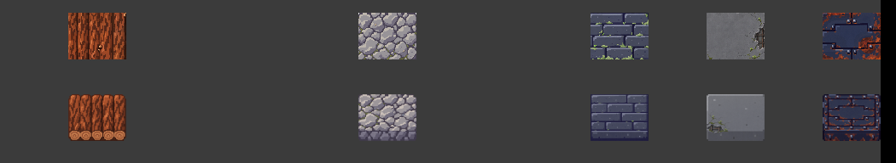

# 环墙单块厚度

游戏只在可见墙沿、缺口和孤立墙块恢复原图轮廓与端面。范围限于有空邻格的墙块内。墙下灰底、内侧阴影、占地、碰撞、耐久和地图沿用原实现。

- 母版沿用墙块素材库的 36 张 PNG。每张的路径、SHA-256、顶面和端面裁切矩形见 `asset-library/01_islands_sky/flying_garden_wall_tiles_v1/integration_catalog.json`（清单 SHA-256 为 `dd390e9a18ea5d9a29735b2ead8e4a96a47a39a200fa0add2c51bec070639373`）。
- 在项目根目录运行 `python game/art_templates/complex_ui/pack_exposed_walls.py` 复建图集。80×64 逻辑格内，顶面占 50 像素、朝下端面占 14 像素。最近邻采样；世界格坐标决定变体。四邻都空时直接显示整块，连墙只在外露边过渡到原图。
- 使用图形模式运行 `godot --path game --script res://tests/ring_wall_depth_preview.gd`，输出至 `artifacts/game/wall-block-depth/`。东西向对照镜头倍率 0.85，固定缺口中间留五个单块。北侧完整墙沿倍率 1.0。前后图均从游戏环墙的实际渲染视口取得。
- 两组截图逐像素比较，缺口场景变化 65894 像素，北侧变化 40580 像素。按四邻占用计算允许范围，两次范围外差异均为 0 像素。环墙碰撞、破坏和存档测试通过。

同镜头实机对照，上排为原效果，下排为带外露端面的墙块。

图集重建使用项目本地美术库。游戏运行直接读取已提交的 PNG 图集。
